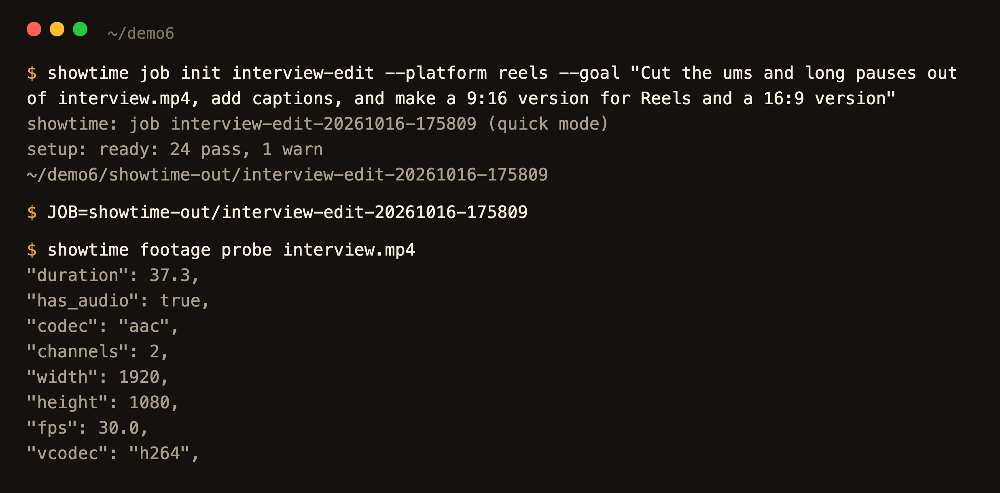
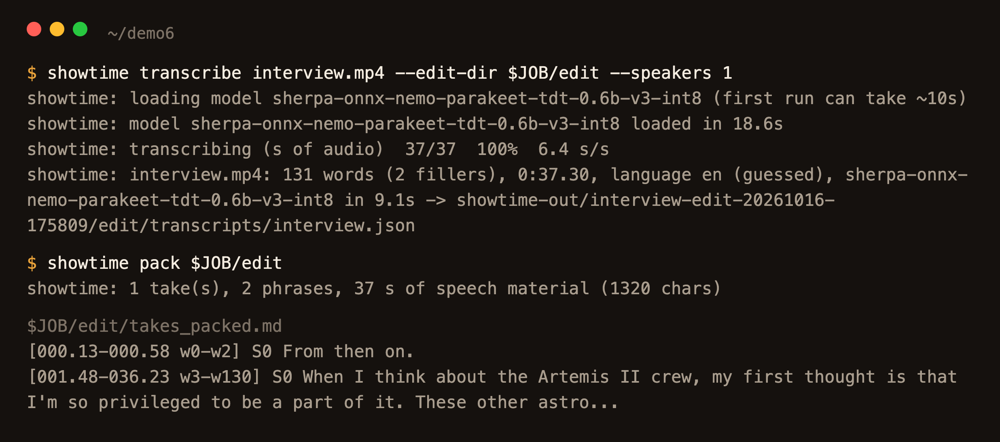
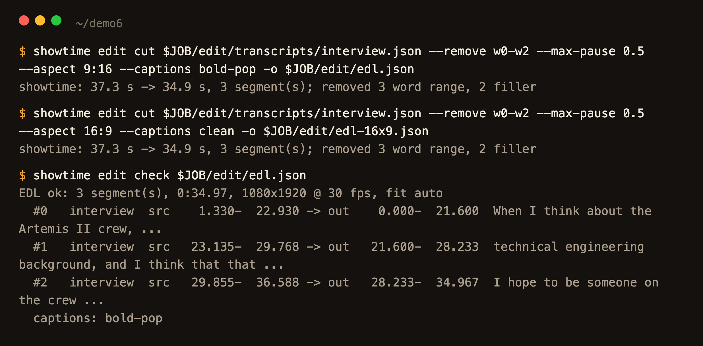
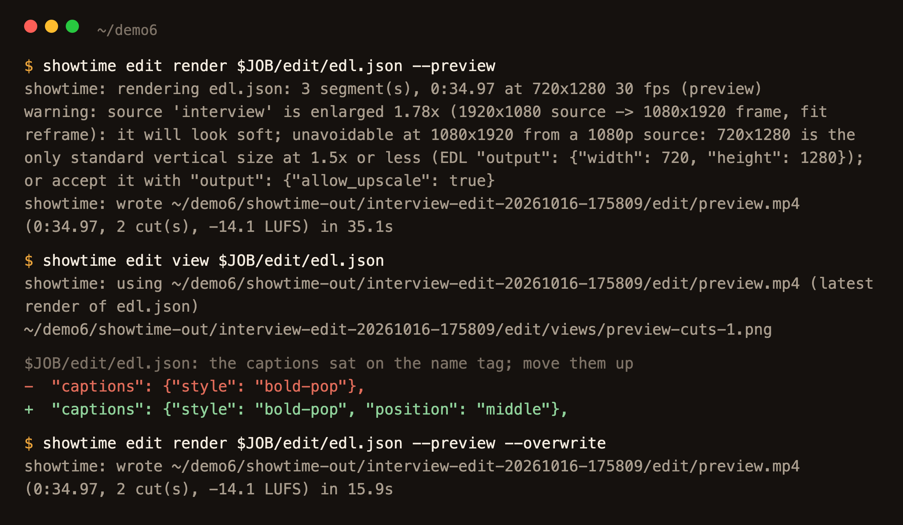
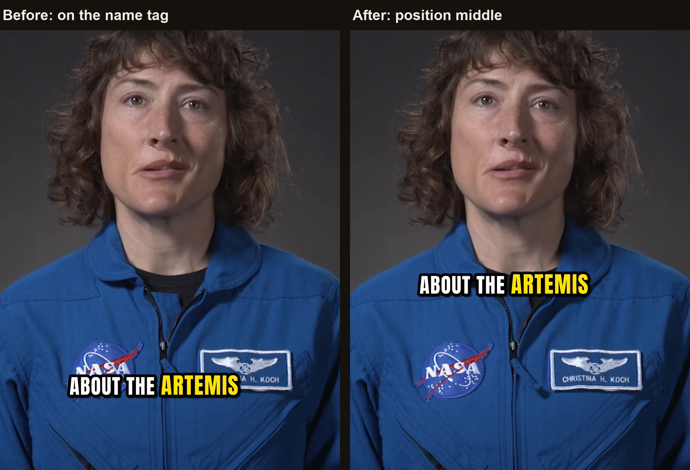
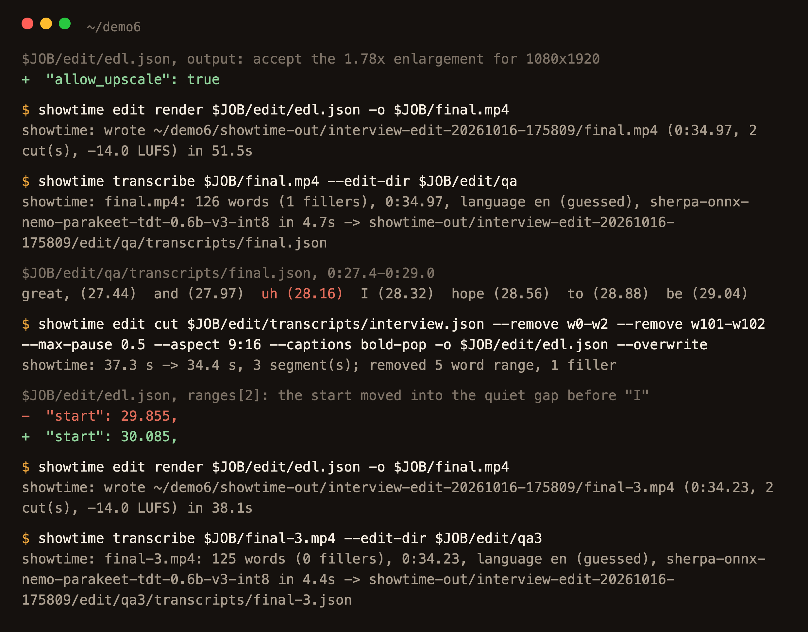
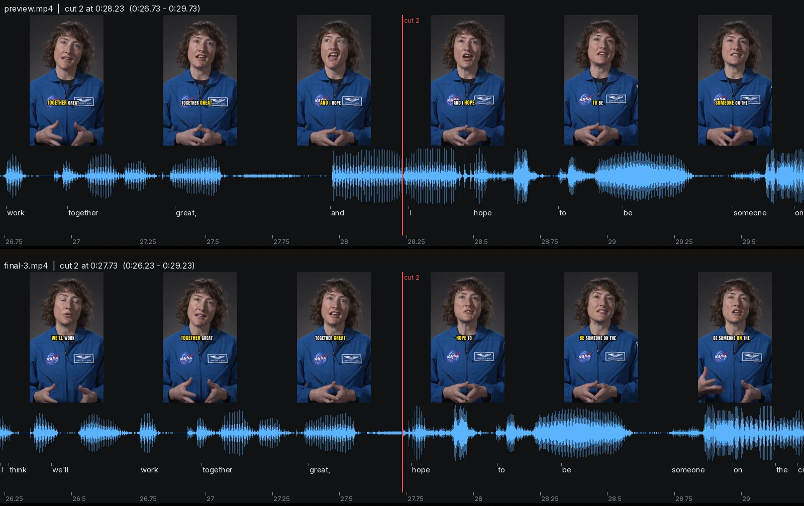
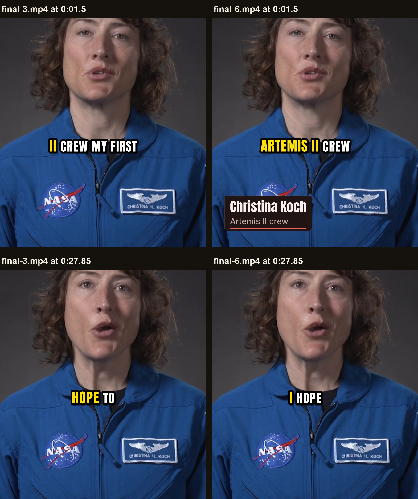
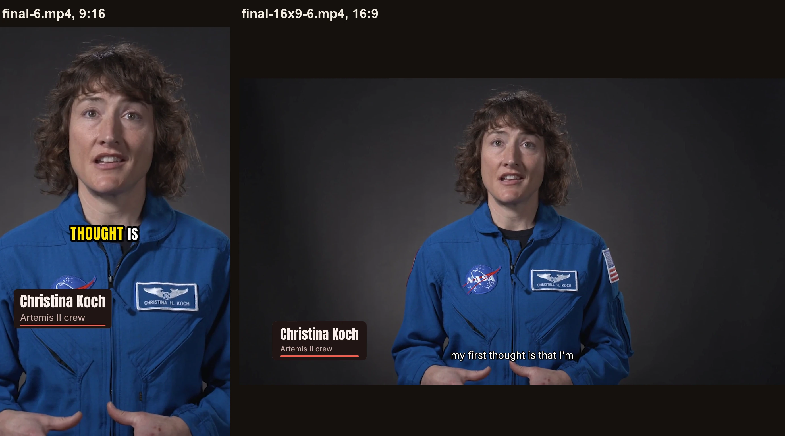
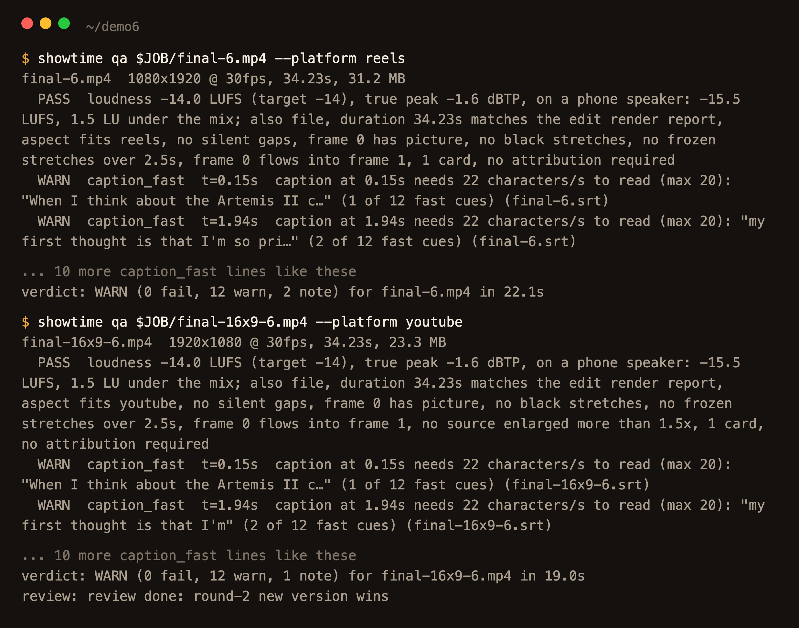

# Edit your own footage: cut the ums, caption it, 9:16 and 16:9

<!-- tutorial: numbered steps, each with a screenshot from one real run -->

You have a clip of someone talking, and it needs the ums and long pauses taken out, captions burned in, and a
vertical version for Reels next to the wide one. showtime edits it by its words: it transcribes the clip, cuts
by the transcript, and renders from a cut list, so your file is never changed. This guide follows one real run
on a 37-second interview, with a picture of each step.

<!-- video: examples/_tutorials/edit-footage/clip.mp4 -->

## Say this

> "Cut the ums and long pauses out of interview.mp4, add captions, and make a 9:16 version for Reels and a 16:9
> version."

The clip is a public-domain NASA interview with Christina Koch (see [The example](#the-example)); the terminal
output in the pictures is trimmed to the lines that matter.

## 1. Your agent starts a job and looks at the clip

`showtime job init` makes the job folder that keeps every file of this edit, and `showtime footage probe` reads
the clip: 37.3 s, 1920x1080 at 30 fps, H.264 with stereo sound.

## 2. It transcribes every word

`showtime transcribe` writes a transcript with a time for every word, and keeps the ums and uhs as words (here
2 of them), because they are where the cuts go. `showtime pack` turns it into a short list of phrases with word
ids that your agent reads instead of the whole file. The first phrase, "From then on.", is the end of the
previous answer in NASA's reel.

## 3. It cuts the fillers, the long pauses and the stray first words

`showtime edit cut` turns the transcript into a cut list (an EDL): fillers out by default, pauses over 0.5 s
shortened to 0.3 s (`--max-pause 0.5`), and `--remove w0-w2` takes out "From then on.". A cut never falls inside
a kept word, and each edge moves to the quietest point within 40 ms. The same cut is made twice, once at 9:16
with bold word-by-word captions and once at 16:9 with clean sentence captions. `showtime edit check` lists the
three kept stretches and where each lands in the output: 37.3 s down to 34.97 s.

## 4. It previews, and looks at every cut

A preview renders at 720x1280 in about half a minute. `showtime edit view` draws each cut as a strip: frames, the
waveform and the words, so your agent sees a cut and hears it on the same picture. Here the captions sat on her
NASA patch and name tag, the spot the default bottom band takes in a tight vertical crop, so the agent moved them
up with `"position": "middle"`. The preview also warned that a 1080x1920 frame from 1080p footage enlarges it
1.78x.

## 5. It renders the final and listens to it

The final renders at 1080x1920 once the enlargement is accepted (`"allow_upscale": true`). Then your agent
transcribes the final itself, to hear what a viewer hears. It found one "uh" left after "and", at 0:28.2: the
transcript had put the "uh" a little early, so the cut kept its end. The agent removed "and uh" (`--remove
w101-w102`) and moved the start of the last stretch into the quiet gap before "I". The next final's transcript
has no filler.

## 6. The critic watches it, and your agent fixes what it found

In quality mode (the default) a critic watches every finished video before delivery, from a review pack
(`showtime review-pack`) with frames, cut strips, the sound measured and the captions. On `final-3.mp4` it found
no blocker and three should-fixes:

- the hook caption split the mission name, "ABOUT THE ARTEMIS" then "II CREW MY FIRST";
- right after the second cut the caption read "HOPE TO": the transcript times that "I" a little early, so most
  of the word looked cut, and a word keeps its caption only when at least half of it is inside the edit;
- nothing on screen said who she is.

The agent captioned the final from what the final itself says: it took the words of `final-3.mp4` from step 5,
joined the mission name into one word (the text only; no time moved), wrote the captions with `showtime captions`
and burned them through the EDL's `subtitles` instead of `captions`. It added a lower third with her name and
"Artemis II crew", her own words. Then a second, blind round compared the new render with the old one, twice,
in both orders: the new one won both times.

What was left, your agent fixes or waives with a reason, and every waiver goes into the receipt. Here it waived
five: her pace twice (her own speech, about 220 words a minute, never sped up or slowed), the quiet ending (her
voice falls the same way in the source, and the shot ends 0.4 s after her last word), an on-screen credit (NASA
material needs none; the guide and the post credit it), and the card over the NASA patch, because in 9:16 the
only room under the patch is where Reels puts its own buttons and text.

## 7. Both versions, checked

The 16:9 version gets the same captions in the clean style, the same card and the same look: the agent set
`"look": "redline"` in both EDLs, because each had picked its own. Both pass qa. The 12 warnings are the sidecar
`.srt` cues for a platform's caption upload, which need 21-28 characters a second at her pace; the burned
captions follow her word by word. The 16:9 film had its own critic round: no blocker, and its four should-fixes
(caption speed, a jump cut, the quiet ending, the pace) were waived; a plain cut is the default this guide shows.

You get `final-6.mp4` (9:16) and `final-16x9-6.mp4` (16:9) with their `.srt` files, the EDLs, every earlier
render, the transcripts, cut sheets and critic's rounds in the job folder; `interview.mp4` is unchanged.

## How long it takes

Measured for this guide on a 6-core Intel Mac, with other jobs running:

| Step | Command | Time |
|---|---|---|
| Transcribe the 37 s clip, the model's first load included | `showtime transcribe interview.mp4 ...` | 34.6 s |
| Preview at 720x1280 | `showtime edit render <edl> --preview` | 35.1 s, 15.9 s again |
| Final at 1080x1920 | `showtime edit render <edl> -o final.mp4` | 38-56 s |
| Final at 1920x1080 | `showtime edit render <edl-16x9> -o final-16x9.mp4` | 30-41 s |
| Transcribe a final to check it | `showtime transcribe final.mp4 ...` | 4.4-4.7 s, plus 3 s to load the model |
| qa | `showtime qa <final>` | 11-24 s |

The cut, the check and the captions take about a second each; the critic's rounds were not timed.

## Phrases that change it

- "Keep the ums" adds `--keep-fillers`; "also cut you know and I mean" adds `--filler-set en-discourse`.
- "Leave the pauses as they are" drops `--max-pause`.
- "Boxed captions" or "clean captions on the vertical one too" picks another style (`clean`, `boxed`, `minimal`).
- "Make it 720x1280" keeps the vertical version sharp instead of enlarging 1080p footage 1.78x.
- "Add her name" adds a lower third; "no cards" leaves them out.

## Limits

- The 9:16 version is 1080p footage enlarged 1.78x, so it is softer than the 16:9 one; 720x1280 keeps it at 1.2x.
- Fast speech gets honest `caption_fast` warnings on the `.srt`; the cues are not slowed or merged to hide them.
- A word right after a cut can lose its caption when the transcript times it early, as the "I" did here.
  Captioning the final from its own transcript fixes it; check each cut on the cut sheet either way.
- One cut edge was moved by hand (step 5); the final's transcript is the check, and the next one found no "uh".
- Besides the fillers, only "From then on." and "and" were cut from the clip, itself cut from NASA's longer reel.
- The pictures are at twice their size or more, from this run; the step 4 before frame was rendered again.

## The example

<!-- example: 06 -->
The clip is 1:42.3-2:19.6 of NASA/JSC item
[`jsc2023m000095`](https://images.nasa.gov/details/jsc2023m000095_Christina_Koch_Artemis_II_Crew_Announcement_Resource_Reel-social),
an interview recorded in 2023 for the Artemis II crew announcement. It is NASA-produced media, public domain
under [NASA's media usage guidelines](https://www.nasa.gov/nasa-brand-center/images-and-media/). NASA did not
make, review or endorse this edit or showtime. [Example 06](https://github.com/FavioVazquez/showtime-examples/tree/main/examples/06-footage-edit-nasa) is a longer
excerpt of the same interview, edited the same way. The full rules are in [editing.md](../../skills/showtime/references/editing.md) and [captions.md](../../skills/showtime/references/captions.md).
