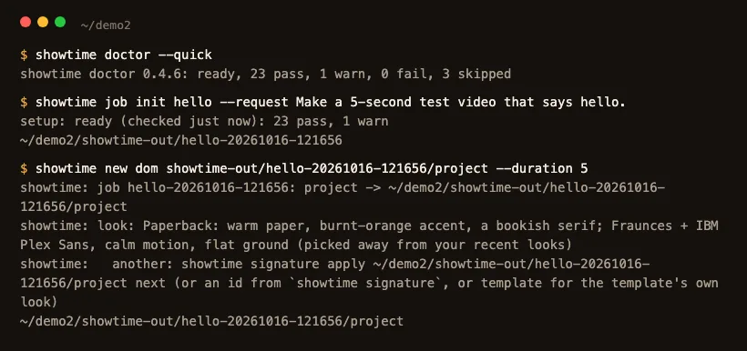
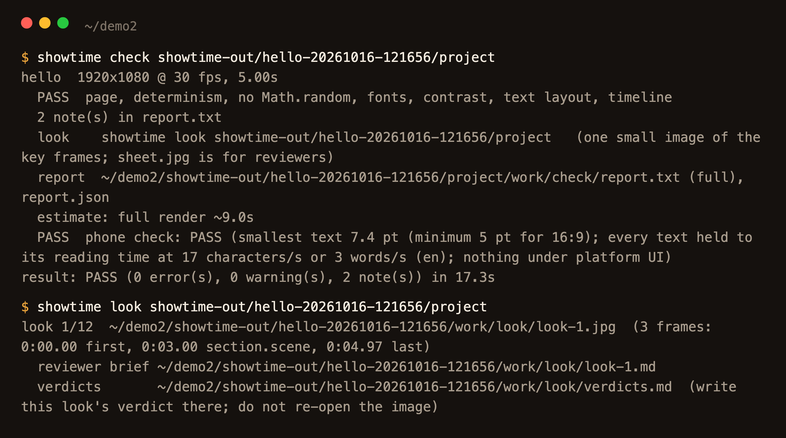
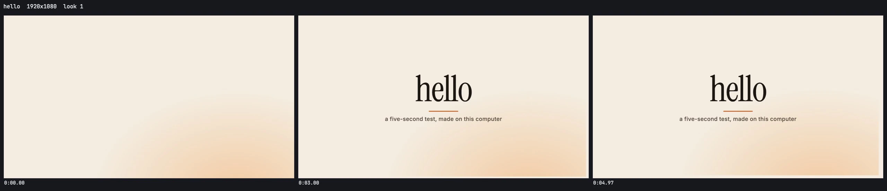
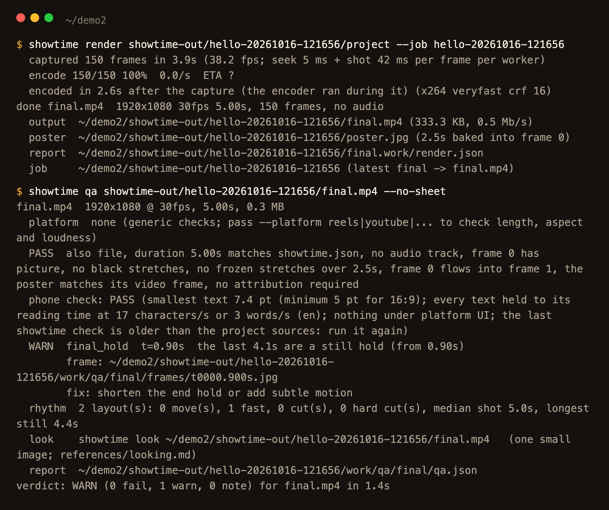
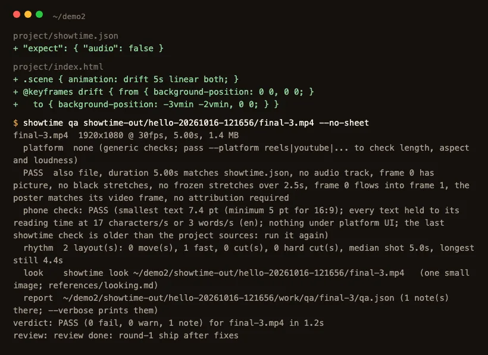
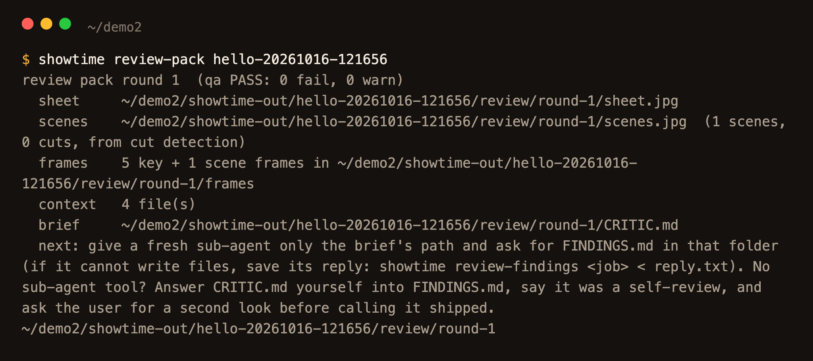
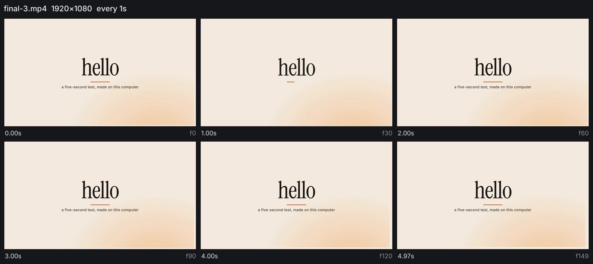
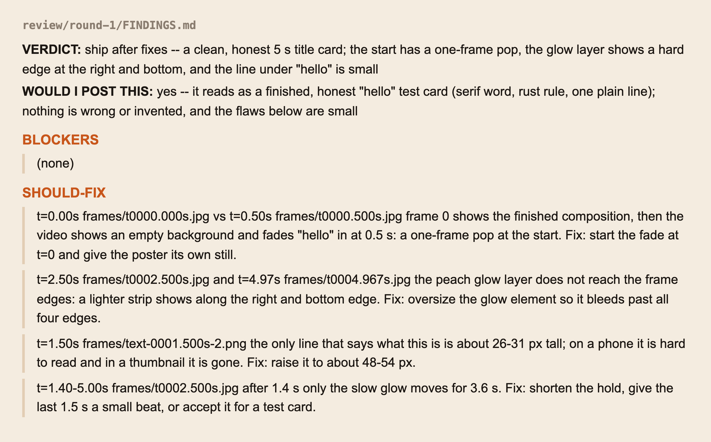
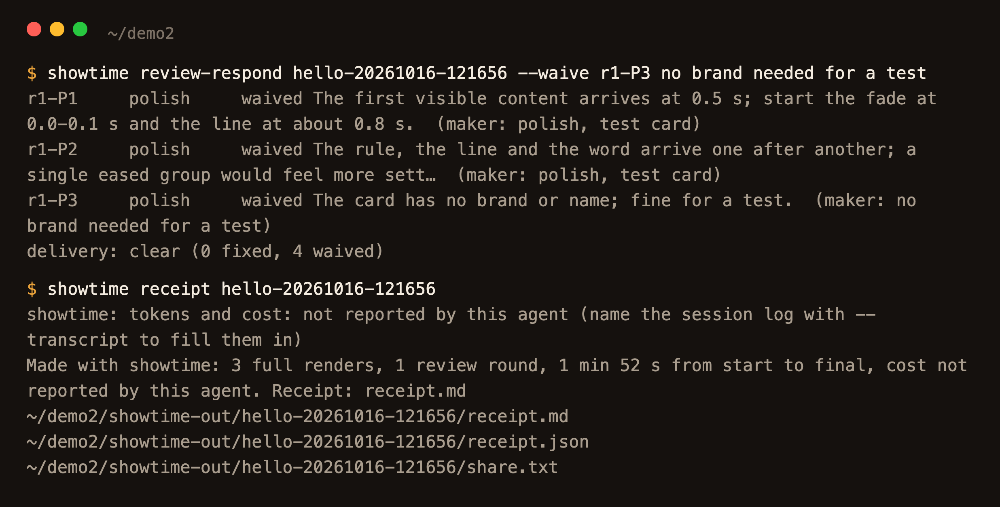
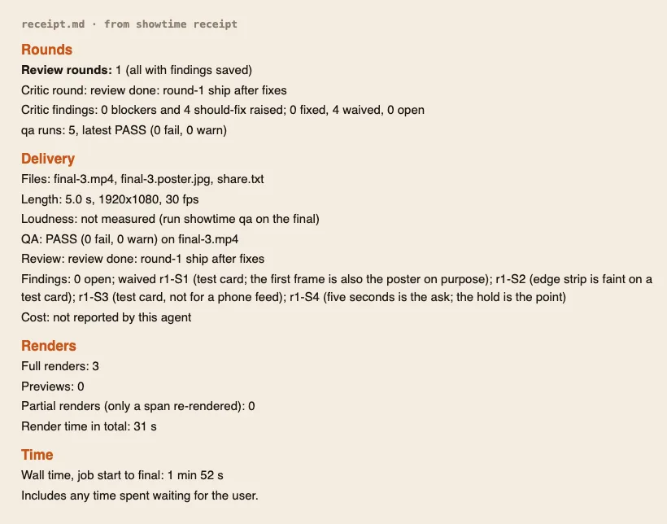

# Make your first video

<!-- tutorial: numbered steps, each with a screenshot from one real run -->

Start here if you have never used showtime. Ask for a 5-second test video: your agent installs what is missing, makes
the video on your computer, checks it and has it reviewed. You learn that the install works, and you see every step a
bigger video goes through. This guide follows one real run, with a screenshot of each step.

<!-- video: examples/_tutorials/first-video/clip.mp4 -->

## Say this

Install [uv](https://docs.astral.sh/uv/) and [Node.js](https://nodejs.org) 24 or 22 LTS (20 or newer works), check
them with `uv --version` and `node --version`, and restart your coding agent. Add showtime to it (Claude Code:
`/plugin marketplace add FavioVazquez/showtime`, then `/plugin install showtime@showtime`; other agents:
[agents.md](../agents.md)). Then open an empty folder and type:

> "Make a 5-second test video that says hello."

Your agent writes one line of assumptions before anything runs ("Quick mode: 5 s, 16:9, no voice-over; full review,
say 'lean' for a draft pass"). It asks a question only when a request could mean two different videos.

## 1. Setup and a job folder

The first time only, `showtime job init` stops with "setup has not been run yet". Your agent tells you the download
(about 0.5 to 0.75 GB, usually 2 to 6 minutes; `showtime setup --estimate` prints yours) and runs `showtime setup` once
you say yes. A sandbox blocks it? See [Troubleshooting](../troubleshooting.md#setup-never-ran-or-the-sandbox-blocked-it).

Then the job: a folder, `showtime-out/hello-<date>-<time>/`, for everything this request makes
([what is in it](../glossary.md#the-job-folder)). `showtime new dom` copies a starter page into it, fits it to 5 s and
dresses it in a [look signature](../glossary.md#look-signature).

The terminal output in the pictures is trimmed to the lines that matter.

## 2. Your agent writes "hello" and checks the page

Your agent writes the word into the page, `showtime check` tests it before any render (fonts, contrast, text layout,
that nothing moves by chance), and `showtime look` makes one small image of the key frames.

The look image is the first thing you can judge: three frames of the page, with nothing rendered yet.

## 3. The first render, and what qa says

`showtime render` draws every frame in a headless browser on your computer. Nothing is uploaded. Then `showtime qa`
checks the file itself: the codec, black or frozen stretches, the poster, the loudness, and what the project says to
expect. Here it warns that the last 4.1 seconds are a still hold.

## 4. Fix it and render again

Renders never overwrite, so the fixed renders are `final-2.mp4` and `final-3.mp4`. Your agent made two changes:
a slow drift on the glow so the end is not frozen, and a line in `showtime.json` that says this film is meant to be
silent, so qa does not ask for music. The fixed file passes.

## 5. Open the video

`final-3.mp4` (1920x1080, 30 fps) and its poster are in the job folder. Open the file: that is your first video. The
frames below are from the run itself.

## 6. A critic reviews it

In quality mode (the default) the finished video is reviewed before it counts as done. `showtime review-pack` makes
a pack of contact sheets, key frames and the qa result, and a second agent, which sees only that pack, writes its
findings.

## 7. Read the findings and answer each one

The verdict here was "ship after fixes": no blockers, four should-fix points and three polish notes. Every finding is
fixed or waived with a reason. Blocker and should-fix findings hold the delivery until they are answered (until the
critic's verdict is in, `showtime qa` and the delivery say "review pending"); polish notes never do. For this test
card all seven were waived, and the reasons are in the receipt:

- a one-frame pop at the start: the first frame is also the poster, on purpose;
- a glow that stops short of the right and bottom edges: the strip is faint on a test card;
- a small line of text: this card is not for a phone feed;
- a 3.6 s still stretch: five seconds is the ask;
- the three polish notes (timing of the fade, the three parts arriving one after another, no brand on the card): not
  needed for a test.

On a real video you would fix the should-fix points and render again; the [review and notes guide](notes-and-fixes.md)
shows that.

## 8. The receipt

`showtime receipt` writes `receipt.md`: the request as you typed it, the review rounds and what became of each
finding, the renders, the time, and the tokens and cost when your agent reports them. `share.txt` holds one line of it.
The delivery card your agent shows you has the same facts and three things you could ask for next.

## How long it takes

Measured for this guide on a 6-core Intel Mac, with other jobs running:

| Step | Command | Time |
|---|---|---|
| Make the job and check setup | `showtime job init hello --request "..."` | 6.7 s |
| Copy and fit the starter page | `showtime new dom <job>/project --duration 5` | 0.8 s |
| Check the page | `showtime check <job>/project` | 17.3 s |
| Render 5 s at 1080p | `showtime render <job>/project --job <job>` | 6.5 s (3.9 s capture, 2.6 s encode) |
| Check the file | `showtime qa <job>` | 1.2 to 2.5 s |

Setup comes first, the first time (usually 2 to 6 minutes). Your agent's writing and the critic's review come on
top and were not timed. More numbers: [render § Speed](../../skills/showtime/references/render.md#speed).

## Phrases that change it

- "Show me options first" (or "studio") opens a local board where you pick a concept, a look and a storyboard first.
- "Lean" skips the critic, for a cheaper draft pass; `showtime config mode lean` makes it the default.
- "With a voice-over" adds narration from a voice on your machine; "in Spanish" changes its language.
- "Vertical" makes a 9:16 video for Reels, Shorts or TikTok.

## Limits

- The test video is a starter page with your word in it. A real video needs something to work from: a repo, a site,
  a brief, footage.
- Setup needs the network once. Bigger pieces (the transcription model, Manim, music tracks) download the first time
  a video needs them, with their size shown first. The test video downloads nothing more.
- The qa output in steps 3 and 4 was printed again on the saved files for the screenshots, after the silent-film line
  was in `showtime.json`, so it shows the still-hold warning only. The findings in step 7 are shortened from the
  critic's reply. The look image and the review sheet were made again at twice their size for this page: the look
  from the finished project (the glow's drift is the only change), the sheet from the same six frames of
  `final-3.mp4`. Something failed? Ask your agent to run `showtime doctor`, then see [Troubleshooting](../troubleshooting.md).

## The example

For what a bigger request makes, see [example 01](https://github.com/FavioVazquez/showtime-examples/tree/main/examples/01-launch-tidepool): a 20-second launch video for
Tidepool, a fictional notes app, made in quick mode from its landing page and app screens, with composed music and
no voice-over (1920x1080, 17.0 MB, after a critic review). Then try it on your own repo with
[launch video from your repo](launch-video-from-repo.md), or pick another task from the [guides](README.md).

Next: [choose your path](../README.md#choose-your-path), the workflow that matches what you want to make.
