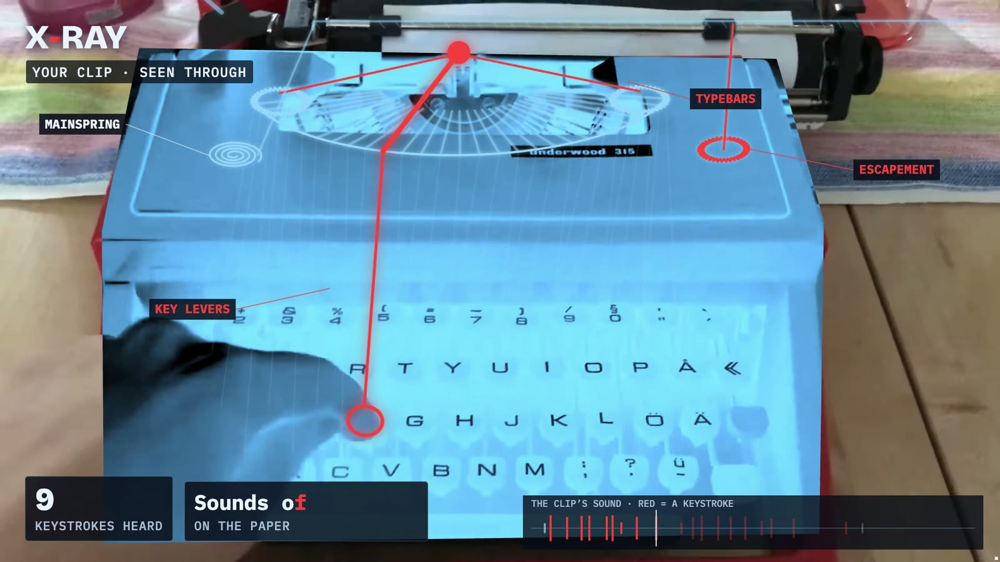
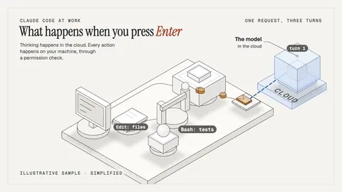
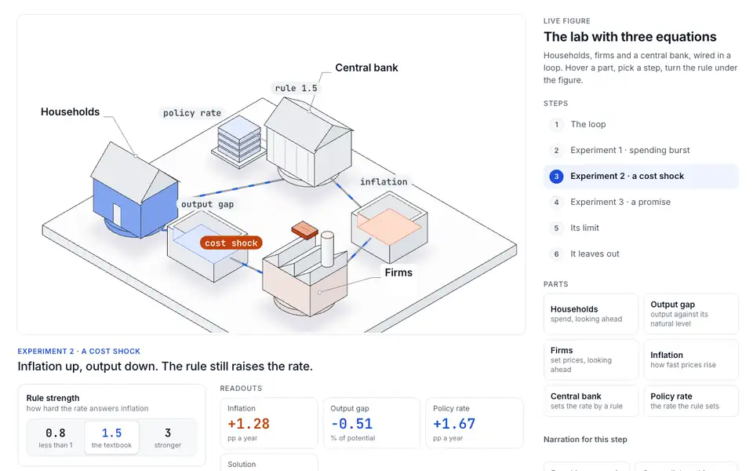
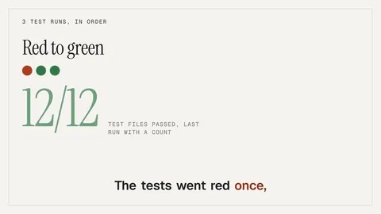
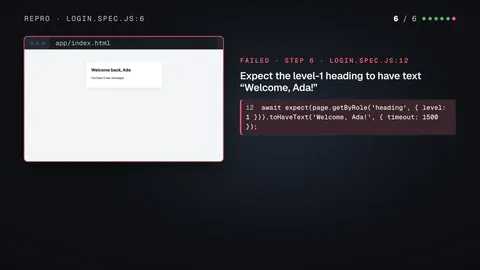
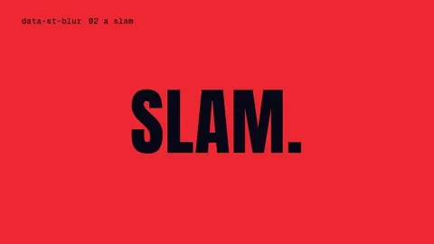
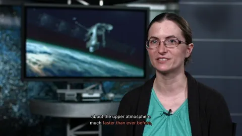
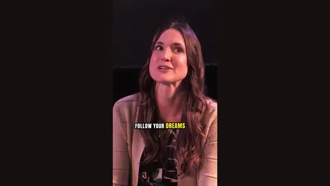
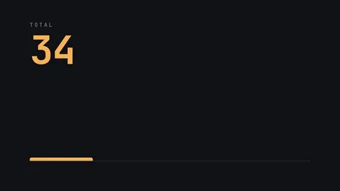

# What's new

What each release changes for you, newest first, one sentence a feature. The
[changelog](../CHANGELOG.md) has every change and the reason for it.

## 0.4.5

### X-ray from data

`showtime xray import <events.csv|json> --job <job> --time-map SLOW,T0` turns event times measured in data (the peaks of
a signal, a sensor log) into an X-ray film. Film time is (t_data - T0) x SLOW, each event lands on its frame, and
`--source` names the sound the film plays so `xray verify` can check it. The live page's commands then start with
`xray import`.

### X-ray of a recording with no picture

`xray analyze` takes a WAV: the events land on a frame grid (30 fps, or `--fps`), and the page draws the picture side.
`xray notes` takes one too, always at 30 fps.

### The live page says what it knows

It states how the events were measured, the sound or a data stream and its note (`"xray".measured` lets you say it
yourself), and shows your own steps when `"xray".made.commands` lists them. The export warns about a command that would
not run or a local path. The page, the gallery and the guide also say what sharing a page shares: its prompt and
commands, the whole `xray` block, the source's name and sha256 and, from data, the events file's name, sha256 and
columns.

### The skill routes by family

SKILL.md sends a request to one of six families (something that happened; a product, repo, site or paper; an idea or a
system; numbers; your own media; a format) in 1,200 words or fewer, and flags live in the guides and `--help`. The
skill also loads now for an interactive figure or living diagram for a web page, and a logo sting, lower third or title
goes straight to the transparent render for an editor (`render --alpha`). Contributors get a routing eval
(`benchmarks/routing-eval/`, one case per workflow guide) and a release check that wants a case for each new guide.

### `footage trim -o` writes the file you name

An existing file is refused unless you pass `--overwrite`, and `-o` naming the input clip is refused whatever its
spelling. Without `-o` nothing changes.

### The embed element takes only safe addresses

`<showtime-xray src>` loads a relative, http(s) or `file:` page and nothing else, in a frame that may run its own
scripts and nothing more.

### Living diagrams on a phone

The Type field takes a paste or an input-method burst 200 characters at a time, keeps a Chinese, Japanese or Korean
composition until you commit it, works with Android Backspace and no longer zooms the page on iOS. Letters, Space, Enter
and Backspace pressed on a focused slider, button or link are no longer typed on the board.

### Small fixes

An X-ray project without notes passes `showtime check`. The heat pump's tags show what the scene computes (63 °C, not
70 °C). Recap finds a session's files under a Windows 8.3 folder name. A screenshot that hits its time limit now
says when the browser was stuck.

## 0.4.4

### X-ray: film a real thing and see its inside

Film something doing its thing (a typewriter, a music box, a guitar, a drum kit) and showtime finds every event in the
clip's own sound and draws the inside moving on exactly those frames: on the object as the camera moves, beside it or as
an isometric diagram, in a dark radiograph or a light blueprint. `showtime xray analyze` measures, `showtime new xray
--mechanism <object>` starts from a library of six mechanisms (typewriter, music box, switch, piano, guitar, drums),
`showtime xray notes` writes a score, a guitar tab or a drum sheet from the sound, and `showtime xray verify` reads
the finished film back for a receipt: "19 of 19 events on their frame · audio 0.0 ms from the original"
([guide](guides/xray.md), [xray](../skills/showtime/references/workflows/xray.md), [the gallery](https://faviovazquez.github.io/showtime/xray/)).

### A live page you play

`showtime export html <xray project> --interactive` writes one offline page of the same film: pads under the picture
play the next hit from the real clip with its sound, your keyboard types on the typewriter, dragging scrubs, and
`#hit4` links to a moment. The page shows the request that made it (`--prompt`) and the commands, and embeds with
`<showtime-xray>` or an iframe. On the site, every film in the gallery plays live in place.

### Living diagrams you touch

A figure's scene can now take typing, a click on a part and a drag on a part. `showtime new diagram --example
typewriter` is a typewriter you type on, `--example computer` follows a key press from the keyboard to the screen, and
the heat pump's outdoor unit drags to change the weather ([guide](guides/living-diagram.md)).

## 0.4.3

### Living diagrams: a system that explains itself

`showtime new diagram` draws how something works as an isometric figure that builds over time: parts arrive in the
order that explains them, flows, packets and state changes move through them, labels land when their part matters,
and the camera chooses what to look at, in a light, dark or white theme. `--example enter` (a coding agent's loop),
`--example market` and `--example econ-lab` start from finished scenes
([guide](guides/living-diagram.md), [diagram](../skills/showtime/references/workflows/diagram.md), [the demo](https://github.com/FavioVazquez/showtime-examples/blob/main/examples/_diagram/README.md)).

### Live figures people poke

`showtime export html <project> --interactive` writes the same scene as one offline page with no player: hover a part
to light it and read its value, pick a step to run it on the board, turn a knob and the numbers answer at once.
Keys, deep links to a state, reduced motion and a phone layout come with it, and `showtime check` walks every state
before you share it ([html-export § Live figure](../skills/showtime/references/html-export.md#live-figure),
[try one](https://faviovazquez.github.io/showtime/examples/_diagram.html)).

### A recap of your agent's session

`showtime recap --latest` turns a Claude Code session into a 30-60 s narrated film of what the agent did, made from
the session log on your machine through an allow-list of facts (repository-relative paths, program names, test
counts, git stats), never the transcript's own text; nothing renders until you have read `script.md`
([guide](guides/session-recap.md), [recap](../skills/showtime/references/workflows/recap.md), [the demo](https://github.com/FavioVazquez/showtime-examples/blob/main/examples/_recap/README.md)).

### A failing test as a bug-report video

`showtime repro` turns a failing Playwright test into a narrated video of its steps and the failure, slowed down,
with `repro.md` to paste into the issue; typed values are never shown or spoken
([guide](guides/bug-report-video.md), [repro](../skills/showtime/references/workflows/repro.md), [the demo](https://github.com/FavioVazquez/showtime-examples/blob/main/examples/_repro/README.md)).

### Steadier renders and quieter sound

Every render worker now captures from a page set up like the first one, so a busy machine no longer ships bare
frames from a worker whose page opened short ([render](../skills/showtime/references/render.md)). Recap and repro
pick their music per session or test (a rerun keeps it, `--music` pins it; a catalog track is downloaded once from its
creator's site, nothing is sent, and `SHOWTIME_OFFLINE=1` keeps it all local), and generated videos no longer put a
sound on every cut (`--cut-sounds` adds a soft swoosh back); the transition sounds are softer everywhere.

### How showtime is built

A new page on the site, [how showtime is built](https://faviovazquez.github.io/showtime/harness/), is the crew's
operating manual: who does what, and how a task becomes a merged pull request or a film. The site and the repository
now share one link-preview image.

## 0.4.2

### Render a film in chapters, with one soundtrack

`showtime render --chapters` plans the pieces from your chapters (or the film's acts), `--chapter N --job J` renders
one, and `--join --job J` joins them and builds the soundtrack once for the whole video, so there are none of the
loudness steps (2.6 and 0.7 dB) that joining separately mastered sections gave. Every seam is checked against a
master before the file is named `final.mp4`, and after a whole render or a join a later fix to one chapter re-renders
exactly its frames. On one machine a whole render is faster: use chapters for a second machine (not measured), a
later fix of one chapter, or a long film
([render § Speed](../skills/showtime/references/render.md#speed)).

### A browser window resized late no longer ruins a render

Under heavy load a whole capture lane of a normal render could come out at the wrong size: with 3 workers, 7 of 40
renders on a 6-core Intel Mac with a GPU had a wrong lane, and 0 of 30 do after the fix (the same fix makes `--scale 2` real on a
Mac). A page that gets the wrong size is set again and the frame captured again, and `render.log` says so
([render](../skills/showtime/references/render.md)).

### More browsers without a GPU, and a frame that never comes

Without a GPU, `--workers auto` now uses CPU threads - 2 from 8 threads up (at most 8): on an 8-thread machine
without a GPU, auto now picks 6 browsers instead of 3. A frame that never comes no longer stalls a render (when the
browser reports its processes' work; otherwise the 10-minute cap stays): it is drawn again in a new browser (render)
or ends the check with an error. A WebGL canvas that loses its context on the GPU renders again without the GPU
(`--gpu off`) instead of shipping white (without a GPU, render names the canvas and its white frames)
([FAQ](faq.md#do-i-need-a-gpu)).

### Narration that fits, and more local voices

`showtime voice script narration.md -o voice --fit 15 --estimate` says up front whether the narration can fit before it synthesizes a
single line, and extra local voice engines load by name, with `doctor` no longer failing on Kokoro when you chose
another ([voice](../skills/showtime/references/voice.md)).

### Help when something goes wrong, and a first video step by step

A first-video guide, a troubleshooting page by symptom and a glossary are new, `showtime doctor` ends with a link to
the troubleshooting page when a check fails, and the site's docs start on "Start here"
([your first video](guides/first-video.md), [troubleshooting](troubleshooting.md), [glossary](glossary.md)).

## 0.4.1

### Seven looks, no GPU needed

Fluted glass, tilt-shift, liquid metal, mesh gradient, god rays, marble and metaballs are drawn in showtime's own
WebGL, each adds less than 50 ms to a 1080p frame at its default size (one browser on a 64-core machine without a
GPU), and each has a designed fallback where WebGL is missing ([components § 7](../skills/showtime/references/components.md#7-looks-webgl-fluted-glass-tilt-shift-liquid-metal-mesh-gradient-god-rays-marble-metaballs),
[the demo](https://github.com/FavioVazquez/showtime-examples/blob/main/examples/_looks/README.md)).

### Shutter blur on fast moves

Mark the element that moves with `data-st-blur` and it smears the way a camera shutter would, only on the frames it
moves fast, and lands sharp ([stage-api § Shutter blur](../skills/showtime/references/stage-api.md#shutter-blur-data-st-blur-and-stblur),
[the demo](https://github.com/FavioVazquez/showtime-examples/blob/main/examples/_blur/README.md)).

### Cards over a talking head, and a word behind the speaker

Name tags, a list that builds as it is said, a data callout, a pull-quote or a side panel appear as the words are
said, and a big word can stand behind the speaker, cut out on your CPU
([editing § 9](../skills/showtime/references/editing.md#9-cards-graphics-anchored-to-the-words),
[example 23](https://github.com/FavioVazquez/showtime-examples/blob/main/examples/23-talking-head-cards-nasa/README.md)).

### A long recording's best moments, as short clips

`showtime edit moments` ranks the best 20-60 s moments of a podcast, talk or panel on your machine, and
`showtime edit clips` turns the ones you pick into vertical clips with captions, each checked by qa: a 58-minute
panel took about 7 minutes end to end on a 64-core machine
([editing § 10](../skills/showtime/references/editing.md#10-highlights-a-long-recordings-best-moments-as-clips),
[example 24](https://github.com/FavioVazquez/showtime-examples/blob/main/examples/24-highlights-apollo17-panel/README.md)).

### Claude Design to MP4

`showtime adopt <export.zip>` turns a Claude Design animation's HTML export into a 1080p video with sharp text, its
Google Fonts copied in with their licences and exactly one loop of a looping design, ready for music, a voice and
captions ([adopt § From Claude Design](../skills/showtime/references/adopt.md#from-claude-design),
[example 28](https://github.com/FavioVazquez/showtime-examples/blob/main/examples/28-claude-design-to-mp4/README.md)).

### Faster renders, and no GPU needed

<!-- media: speed: a still of a render's progress lines -->

The encoder runs while the frames are captured, an unchanged soundtrack is reused, waits stretch on a slow machine
instead of failing, and without a GPU the number of browsers follows your cores: on a 64-core Linux machine with no
GPU a 30 s launch film rendered in 17.6 s instead of 42.0 s, and a 1 s fix took 13-21 s instead of 31-54 s on a busy
6-core Intel Mac ([render § Speed](../skills/showtime/references/render.md#speed),
[FAQ](faq.md#do-i-need-a-gpu)).

### Link previews for HTML videos

<!-- media: share: a still of a pasted link showing the poster frame -->

`showtime export html --folder --share-url <address>` (or `"share"` in showtime.json) adds the tags that make a
pasted link show a title, a description and the poster frame, and the folder is ready for GitHub Pages
([html-export § Sharing and hosting](../skills/showtime/references/html-export.md#sharing-and-hosting),
[example 25](https://github.com/FavioVazquez/showtime-examples/blob/main/examples/25-nobel-physics-ice-telescope/README.md)'s HTML video).

### Notes on a stretch of time, naming what they point at

<!-- media: notes: a still of the notes page with a stretch band on the scrubber -->

On the notes page (`showtime review open <job>`), Shift + drag on the scrubber marks a stretch, and
`showtime review notes` names the scene and the elements under each spot or box and the scenes a stretch covers,
so your agent fixes the right thing ([review § 6](../skills/showtime/references/review.md#6-notes-on-the-finished-video)).

### Since you last looked

<!-- media: catchup: a still of the "since you last looked" lines of showtime status -->

Edit a job's files by hand, leave notes or pick on a board, and `showtime status <job>` tells your agent what
changed since it last looked, so it keeps your edits instead of writing over them
([FAQ](faq.md#can-i-edit-the-files-myself)).

### The voice-over is heard back

<!-- media: readback: a still of the "heard back" lines of voice script -->

After the voice-over is made, showtime transcribes it on your machine and flags a name, an acronym or a number the
voice said wrong (a name spelled "Open A I" was heard as "OpenI"), with the fix to try
([voice § Pronunciation fixes](../skills/showtime/references/voice.md#pronunciation-fixes)). It runs when the local
recognizer is installed: it arrives with the first transcription, or `showtime setup --fetch
parakeet-tdt-0.6b-v3-int8`. A word you listened to and found right is cleared in showtime.json.

### check catches more before the render

<!-- media: check: a still of check's findings -->

`showtime check` judges a fading text at its clearest frame, warns when something sits where the captions go
(`caption_zone`), tries a WebGPU page again without WebGPU, estimates each look's cost (`look_budget`) and flags
blur on text being read ([render](../skills/showtime/references/render.md)).

### Site fixes

<!-- media: site: a still of a search result opening its section -->

On [the site](https://faviovazquez.github.io/showtime/), search finds names such as `pr-video` and every part of a
long page, a placeholder such as `<title>` in a guide shows as text instead of hiding the rest of the page, and
every page has a link preview.

## 0.4.0 (5 October 2026)

- **Videos that stop and ask.** List questions in showtime.json and the HTML export pauses on that frame, asks,
  marks the answer and plays on; the MP4 gets a "pause and think" beat
  ([example 25](https://github.com/FavioVazquez/showtime-examples/blob/main/examples/25-nobel-physics-ice-telescope/README.md)).
- **Notes on the finished video.** `showtime review open <job>` plays the latest render on a local page where you
  click a spot or drag a box and type a note; your agent reads the notes, fixes and replies.
- **Range links.** `video.html#t=10-20` plays that part of an HTML video on a loop.
- **A pull request becomes a video.** `showtime pr-video <N | URL>` makes a short video for the PR's description,
  with a copy under GitHub's 10 MB attachment limit ([example 29](https://github.com/FavioVazquez/showtime-examples/blob/main/examples/29-pr-video-showtime/README.md)).
- **A storyboard table becomes a project.** `showtime new <template> <dir> --from-storyboard <file>` reads a
  Markdown table of shots ([example 26](https://github.com/FavioVazquez/showtime-examples/blob/main/examples/26-nobel-chemistry-en-es/README.md)).
- **Go all out.** A "showreel" brief turns on a dense tone, and the `showreel` template renders at 16:9, 9:16, 1:1
  and 4:5 with no edits ([example 30](https://github.com/FavioVazquez/showtime-examples/blob/main/examples/30-showreel-four-shapes/README.md)).
- **The critic watches as a first-time viewer**, and its Blockers and Should-fixes must be fixed or waived before a
  job is marked delivered.
- **A hearing pass** reports music over the voice, cut-off lines, long silences and jumps in level.
- **Twelve look signatures.** New projects start in a curated palette, type pair and motion feel, picked away from
  your recent videos ([example 32](https://github.com/FavioVazquez/showtime-examples/blob/main/examples/32-twelve-looks/README.md)).
- **A behaviour scoreboard anyone can rerun**: an agent scored 35/42 with showtime and 25/42 without.

The README has the longer [0.4.0 summary](https://github.com/FavioVazquez/showtime#new-in-040).

## Earlier releases

The README summarises [0.3.0](https://github.com/FavioVazquez/showtime#new-in-030) (quieter runs, full review by
default, style references, the phone check) and [0.2.0](https://github.com/FavioVazquez/showtime#new-in-020)
(every coding agent, a lighter first run, a real music catalog). Everything else is in the
[changelog](../CHANGELOG.md).
